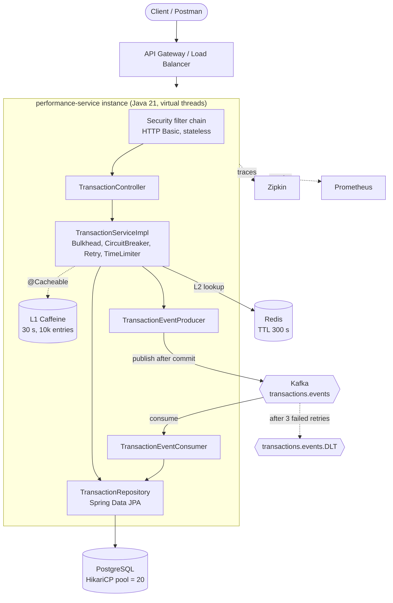
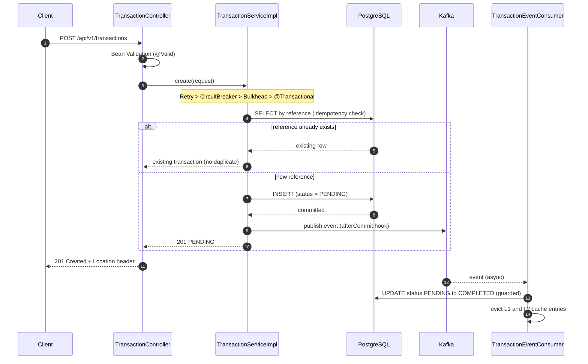
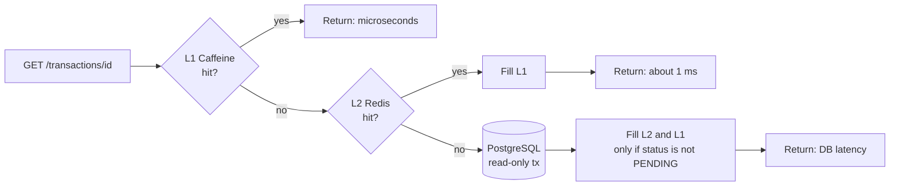
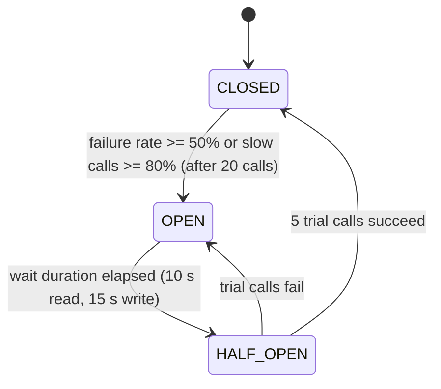
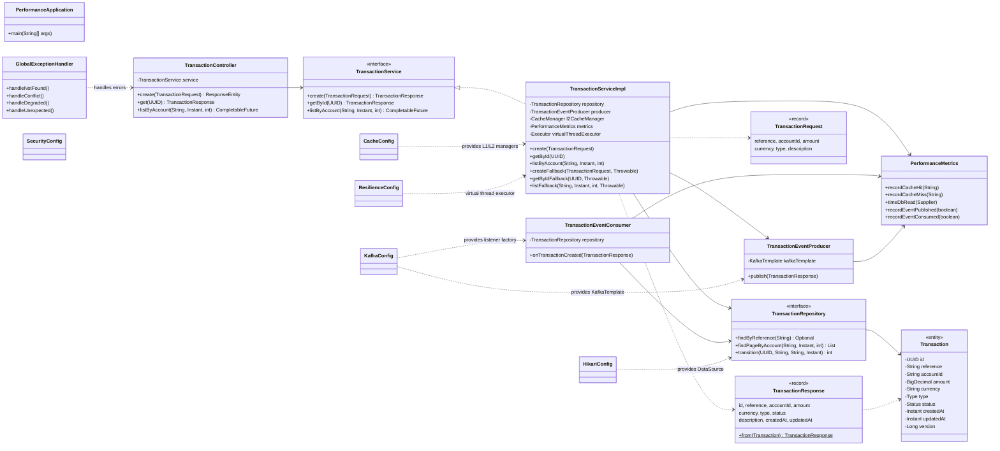

# performance-service

> A Spring Boot 3 / Java 21 microservice that makes a **slow, latency-bound service fast and resilient**, using multi-tier caching, virtual threads, asynchronous event processing and fault-tolerance patterns.

---

## Table of Contents
1. [Purpose: why this project exists](#1-purpose-why-this-project-exists)
2. [How the problem is solved (at a glance)](#2-how-the-problem-is-solved-at-a-glance)
3. [Technology stack](#3-technology-stack)
4. [Architecture](#4-architecture)
5. [Class diagram](#5-class-diagram)
6. [Project structure](#6-project-structure)
7. [Class-by-class reference](#7-class-by-class-reference)
8. [End-to-end walkthrough](#8-end-to-end-walkthrough)
9. [Database design](#9-database-design)
10. [Resilience configuration matrix](#10-resilience-configuration-matrix)
11. [REST API reference](#11-rest-api-reference)
12. [Configuration reference](#12-configuration-reference)
13. [Running the project](#13-running-the-project)
14. [Testing with Postman](#14-testing-with-postman)
15. [Observability](#15-observability)
16. [Design decisions and trade-offs](#16-design-decisions-and-trade-offs)
17. [Known limitations and next steps](#17-known-limitations-and-next-steps)
18. [Troubleshooting](#18-troubleshooting)

---

## 1. Purpose: why this project exists

One of our services was **running slowly and could not return responses quickly**. Typical causes, and what this project does about each:

| Problem seen in the slow service | Root cause | Technique used here |
|---|---|---|
| Every read hits the database | No caching, so repeated identical queries | **L1 Caffeine + L2 Redis** cache in front of PostgreSQL |
| Requests wait while heavy work finishes | Work done inside the HTTP request | **Kafka**: the request only saves a row and returns; processing happens in the background |
| Threads pile up under load | One platform thread per request, blocked on I/O | **Java 21 virtual threads**: blocking I/O is cheap, thousands of concurrent requests |
| Database slows down or is overwhelmed | Too many connections, slow queries, N+1 queries | Small tuned **HikariCP** pool, indexed queries, **keyset pagination** |
| One slow dependency drags everything down | No isolation, no timeouts | **Resilience4j**: Bulkhead, Circuit Breaker, Retry, Time Limiter |
| Duplicate submissions on retries | Non-idempotent writes | **Idempotent create** keyed by a unique `reference` |
| Nobody can see where time is spent | No metrics or traces | **Micrometer + OpenTelemetry + Zipkin + Prometheus** |

The business entity used to demonstrate this is a **financial transaction** (credit / debit / transfer). It is a realistic example: it needs fast reads, safe retried writes and background processing. The same patterns apply to any service with similar traffic.

---

## 2. How the problem is solved (at a glance)

* **Fast reads**: a read first checks memory (L1, microseconds), then Redis (L2, about a millisecond) and only then PostgreSQL.
* **Fast writes**: the API inserts one row and returns immediately with status `PENDING`. A Kafka consumer later marks it `COMPLETED`.
* **Protected system**: if the database or Redis misbehaves, the service retries briefly, then fails fast with a clear `503` instead of hanging, and recovers on its own when the dependency returns.

---

## 3. Technology stack

| Area | Technology |
|---|---|
| Language / runtime | Java 21, virtual threads (`spring.threads.virtual.enabled=true`), ZGC (generational) in Docker |
| Framework | Spring Boot 3.3.4 (Web, Data JPA, Security, Actuator, Validation, AOP, Cache, Kafka, Data Redis) |
| Database | PostgreSQL 16, HikariCP (`max 20`, `min idle 10`) |
| Caching | Caffeine (L1, in JVM) and Redis 7 (L2, distributed) |
| Messaging | Apache Kafka 3.8 (KRaft mode, no ZooKeeper) |
| Resilience | Resilience4j 2.2 (`@Bulkhead`, `@CircuitBreaker`, `@Retry`, `@TimeLimiter`) |
| Observability | Micrometer, OpenTelemetry bridge, Zipkin, Prometheus registry |
| Packaging | Maven, multi-stage Dockerfile, Docker Compose |

---

## 4. Architecture

### 4.1 High-level architecture



### 4.2 Write path (command side)



### 4.3 Read path (query side) with three tiers



Only **terminal-state** rows (`COMPLETED`, `FAILED`) are cached. A `PENDING` row is about to change, so caching it would serve stale data.

### 4.4 Circuit breaker state machine



### 4.5 Decorator order on a service method

Resilience4j wraps the method like layers of an onion. The outer layer runs first:

```
Retry  ->  CircuitBreaker  ->  (TimeLimiter)  ->  Bulkhead  ->  @Transactional  ->  your method
```

The cache aspect is configured with the highest precedence, so it sits **outside all of the above**: an L1 hit returns immediately and never consumes a bulkhead permit or counts toward the circuit breaker.

---

## 5. Class diagram



---

## 6. Project structure

```
performance-service/
├── pom.xml                         Maven build, dependencies, Java 21
├── Dockerfile                      Multi-stage build, ZGC, non-root user
├── docker-compose.yml              Postgres, Redis, Kafka (KRaft), Zipkin, the app
├── ARCHITECTURE.md                 HLD and LLD notes
├── postman/                        Postman collection, environment, TESTING.md
└── src/main/
    ├── resources/
    │   ├── application.yml         All runtime configuration
    │   └── db/schema.sql           Table and index DDL (run at startup)
    └── java/com/enterprise/performance/
        ├── PerformanceApplication.java
        ├── config/
        │   ├── CacheConfig.java
        │   ├── HikariConfig.java
        │   ├── KafkaConfig.java
        │   ├── ResilienceConfig.java
        │   └── SecurityConfig.java
        ├── controller/TransactionController.java
        ├── dto/
        │   ├── TransactionRequest.java
        │   └── TransactionResponse.java
        ├── entity/Transaction.java
        ├── exception/GlobalExceptionHandler.java
        ├── repository/TransactionRepository.java
        ├── service/
        │   ├── TransactionService.java
        │   ├── impl/TransactionServiceImpl.java
        │   └── kafka/
        │       ├── TransactionEventProducer.java
        │       └── TransactionEventConsumer.java
        └── util/PerformanceMetrics.java
```

The layering is the classic one: **Controller -> Service -> Repository / Cache / Kafka**, with configuration, DTOs and cross-cutting code kept separate.

---

## 7. Class-by-class reference

### 7.1 Entry point

| Class | Purpose | Logic |
|---|---|---|
| `PerformanceApplication` | Application bootstrap | Annotated with `@SpringBootApplication`; `main()` starts Spring, which scans all packages below `com.enterprise.performance` and wires every bean. |

### 7.2 `config/` package

| Class | Purpose | Logic |
|---|---|---|
| `CacheConfig` | Builds the **two cache tiers** | `@EnableCaching(order = HIGHEST_PRECEDENCE)` puts the cache aspect outside the resilience aspects. Bean `l1CacheManager` (marked `@Primary`) is a `CaffeineCacheManager`: max 10,000 entries, `expireAfterWrite` 30 s, stats recorded. Bean `l2CacheManager` is a `RedisCacheManager`: TTL 300 s, key prefix `perf:`, string keys, JSON values via a typed `Jackson2JsonRedisSerializer<TransactionResponse>`. A typed serializer is used because Java records are final and generic default typing would not embed type info. |
| `HikariConfig` | Tuned **PostgreSQL connection pool** | Declares the primary `HikariDataSource`, bound from `spring.datasource.hikari.*` (max 20, min idle 10, connection timeout 2 s, leak detection 10 s). A small pool is deliberate: PostgreSQL performs best with few active connections, and virtual threads simply queue cheaply for a connection. |
| `KafkaConfig` | **Kafka producer, consumer, topics, error handling** | Creates topics `transactions.events` and `transactions.events.DLT` (12 partitions). Producer: `acks=all`, idempotence on, LZ4 compression, 5 ms linger, 64 KB batches, JSON serialization with the shared `ObjectMapper`. Consumer: manual offset commits (container managed), `read_committed`, `ErrorHandlingDeserializer` so a poison message cannot crash the listener. `DefaultErrorHandler` retries with exponential back-off (500 ms, x2, 3 attempts) and then publishes the record to the dead-letter topic. Listener concurrency is 3 threads per instance. |
| `ResilienceConfig` | Resilience helpers | Exposes the `virtualThreadExecutor` bean (`newVirtualThreadPerTaskExecutor`) used by the async list query, and a `RegistryEventConsumer<CircuitBreaker>` that logs every breaker state transition (e.g. `CLOSED -> OPEN`). The thresholds themselves live in `application.yml`. |
| `SecurityConfig` | API security | Stateless `SecurityFilterChain`: CSRF off (no browser sessions), no HTTP session, HTTP Basic. `/actuator/health/**`, `/actuator/info` and `/actuator/prometheus` are public; everything else requires authentication. Basic auth keeps the project self-contained; a JWT resource server is the production choice. |

### 7.3 `controller/` package

| Class | Purpose | Logic |
|---|---|---|
| `TransactionController` | REST entry point, base path `/api/v1/transactions` | `POST` validates the body with `@Valid`, delegates to the service and returns `201 Created` with a `Location` header. `GET /{id}` returns one transaction. `GET /account/{accountId}` returns a `CompletableFuture`, so Spring MVC releases the request thread while the query runs. The controller contains no business logic. |

### 7.4 `dto/` package

| Class | Purpose | Logic |
|---|---|---|
| `TransactionRequest` | Input contract (Java record) | Bean Validation: `reference` and `accountId` required, max 64 chars; `amount` at least 0.0001 with at most 15 integer and 4 fraction digits; `currency` must match `^[A-Z]{3}$`; `type` required (`CREDIT`, `DEBIT`, `TRANSFER`); `description` max 255. |
| `TransactionResponse` | Output contract and **Kafka/Redis payload** (Java record) | Immutable. `from(Transaction)` maps entity to DTO. The same record is cached in Redis and used as the Kafka event, which keeps the model small. |

### 7.5 `entity/` package

| Class | Purpose | Logic |
|---|---|---|
| `Transaction` | JPA entity for table `transactions` | UUID primary key **assigned in the application** (saves a database round trip). Nested enums `Type` and `Status` are stored as strings. `@Version` provides optimistic locking. `reference` is unique and non-updatable. `equals`/`hashCode` are based on `id`. There are no lazy associations, so no N+1 problem can arise. |

### 7.6 `repository/` package

| Class | Purpose | Logic |
|---|---|---|
| `TransactionRepository` | Data access (Spring Data JPA) | `findByReference` is the idempotency lookup, served by the unique index. `findPageByAccount` is a **native keyset-pagination query** (`WHERE account_id=? AND created_at < ? ORDER BY created_at DESC LIMIT ?`), served by the `(account_id, created_at DESC)` index. `transition` is a guarded native `UPDATE ... WHERE id=? AND status=?` that also bumps `version`; it returns the number of rows changed (0 or 1), which makes event redelivery harmless. |

### 7.7 `service/` package

| Class | Purpose | Logic |
|---|---|---|
| `TransactionService` | Service contract | Three operations: `create`, `getById`, `listByAccount`. |
| `TransactionServiceImpl` | **Core business and performance logic** | **create:** annotated `@Transactional` + `@Bulkhead` + `@CircuitBreaker` + `@Retry`. Looks up `reference`; if found returns the existing row (idempotent). Otherwise builds a `PENDING` entity, `saveAndFlush`, and registers a `TransactionSynchronization.afterCommit` hook so the Kafka event is only published after the database commit. A concurrent duplicate that loses the unique-constraint race is retried and then returns the winner's row. **getById:** `@Cacheable` on L1 (skipped for `PENDING` results); the method body checks L2 Redis, then PostgreSQL, then writes back to L2. Redis errors are caught and logged, so Redis never causes a request to fail. **listByAccount:** clamps `limit` to 1..200, runs the keyset query on a virtual thread under `@TimeLimiter` (2 s), `@Bulkhead` and `@CircuitBreaker`. **Fallbacks:** `createFallback`, `getByIdFallback`, `listFallback` convert infrastructure failures into `ServiceDegradedException` (HTTP 503) while letting not-found and constraint exceptions pass through unchanged. Fallbacks are attached only to the outermost decorator so an inner fallback never hides an exception the retry should see. |
| `TransactionEventProducer` | Publishes events | `publish()` sends to `transactions.events` with the **account id as key**, so all events of one account go to the same partition (ordering preserved). Completion is handled asynchronously (`whenComplete`), recording success/failure metrics. A failed publish is logged and never breaks the API call. |
| `TransactionEventConsumer` | Background worker | `@KafkaListener` + `@Transactional`. For each event runs the guarded `transition(PENDING -> COMPLETED)`, evicts the id from both caches, and records a metric (`applied` or `skipped`). Because the update is conditional, processing is **idempotent** under Kafka's at-least-once delivery. |

### 7.8 `exception/` and `util/` packages

| Class | Purpose | Logic |
|---|---|---|
| `GlobalExceptionHandler` | Uniform error responses | `@RestControllerAdvice` extending `ResponseEntityExceptionHandler`; every error is an **RFC 7807 `ProblemDetail`**. Contains the nested exceptions `TransactionNotFoundException` (404) and `ServiceDegradedException` (503 with `Retry-After: 5`). Maps `DataIntegrityViolationException` to 409, validation errors to 400 with a field-by-field `errors` map, bad path types to 400, and everything else to a generic 500 (details only in logs). |
| `PerformanceMetrics` | Custom Micrometer metrics | Timer `perf.db.read` (p50/p95/p99 + histogram); counters `perf.cache.requests{tier,result}`, `perf.kafka.published{result}`, `perf.kafka.consumed{result}`. |

### 7.9 Resources and infrastructure files

| File | Purpose |
|---|---|
| `application.yml` | Virtual threads, datasource and Hikari, JPA batching, Redis, Kafka, Resilience4j thresholds, actuator exposure, tracing, logging pattern with trace ids |
| `db/schema.sql` | Table and indexes, executed at startup (`spring.sql.init.mode=always`) |
| `Dockerfile` | Maven build stage, then a slim JRE 21 runtime running as a non-root user with ZGC |
| `docker-compose.yml` | Postgres, Redis (LRU eviction), Kafka in KRaft mode, Zipkin and the app with health-checked dependencies |

---

## 8. End-to-end walkthrough

### Step 0: Application startup

1. `docker compose up --build` builds the image and starts Postgres, Redis, Kafka, Zipkin and then the app.
2. `PerformanceApplication.main()` starts Spring Boot. Virtual threads are switched on, so Tomcat handles each request on a virtual thread.
3. `HikariConfig` creates the connection pool (20 max, 10 idle).
4. Spring runs `db/schema.sql`: the `transactions` table and its three indexes are created if missing.
5. JPA/Hibernate starts (`ddl-auto: none`, the SQL file is the source of truth).
6. `CacheConfig` creates the L1 Caffeine and L2 Redis cache managers.
7. `KafkaConfig` creates the producer, consumer and error handler; Spring's `KafkaAdmin` creates the two topics; listener containers start and join the consumer group.
8. `ResilienceConfig` and Resilience4j auto-configuration register the three breakers, retries and bulkheads from `application.yml`.
9. `SecurityConfig` activates the filter chain; actuator and tracing endpoints come up on port 8080.

### Step 1: A client creates a transaction

`POST /api/v1/transactions` with `reference`, `accountId`, `amount`, `currency`, `type`.

1. The **security filter** validates HTTP Basic credentials (401 otherwise).
2. `TransactionController.create` runs Bean Validation (400 with field errors if invalid).
3. `TransactionServiceImpl.create` is entered through the decorator chain (Retry, CircuitBreaker, Bulkhead) and then a database transaction.
4. The service queries by `reference`. A hit means the client is retrying: the **existing** transaction is returned and nothing is inserted.
5. Otherwise a new row is inserted with status `PENDING` and a random UUID.
6. When the transaction **commits**, the `afterCommit` hook calls `TransactionEventProducer.publish`.
7. The controller returns **`201 Created`** with the body and a `Location` header. The client never waits for the background work.

### Step 2: Background processing

1. Kafka delivers the event to `TransactionEventConsumer` (partition chosen by account id).
2. The consumer runs `UPDATE ... SET status='COMPLETED' ... WHERE id=? AND status='PENDING'`.
3. L1 and L2 entries for that id are evicted. A redelivered event updates 0 rows and is skipped.
4. After 3 failed attempts with back-off, a record goes to `transactions.events.DLT` for inspection.

### Step 3: A client reads the transaction

`GET /api/v1/transactions/{id}`

1. **L1 Caffeine hit** (the cache aspect runs first): returned immediately, no resilience layer touched.
2. **L1 miss:** the method enters Retry/CircuitBreaker/Bulkhead and checks **L2 Redis**. A hit is returned and promoted to L1.
3. **L2 miss:** a read-only query runs against PostgreSQL (timed by `perf.db.read`). `404` if not found.
4. If the row is `COMPLETED` or `FAILED` it is stored in Redis (5 min) and in L1 (30 s). `PENDING` rows are not cached.

### Step 4: Account history

`GET /api/v1/transactions/account/{accountId}?before=<timestamp>&limit=50`

1. The service clamps `limit` to 1..200 and uses `before` (default: now + 1 day) as the cursor.
2. The query runs on a virtual thread with a 2 s time limit.
3. The index `(account_id, created_at DESC)` returns the next page directly; there is no OFFSET scan. For the next page the client passes the `createdAt` of the last item as `before`.

### Step 5: When things go wrong

| Situation | What happens |
|---|---|
| Redis down | L2 errors are caught; reads fall back to PostgreSQL; the request still succeeds |
| PostgreSQL slow or down | Up to 3 attempts with exponential back-off; then `503` + `Retry-After`; after enough failures the breaker opens and requests fail instantly, protecting the pool; it recovers automatically through HALF_OPEN |
| Too many concurrent calls | Bulkhead rejects the excess instead of queueing forever |
| Kafka down | The API still returns `201`; the failure is logged and counted; the row stays `PENDING` |
| Duplicate submit | Same `reference` returns the same transaction |
| Bad input | `400` with a field-level `errors` map |

---

## 9. Database design

```sql
CREATE TABLE IF NOT EXISTS transactions (
    id          UUID           PRIMARY KEY,
    reference   VARCHAR(64)    NOT NULL,
    account_id  VARCHAR(64)    NOT NULL,
    amount      NUMERIC(19, 4) NOT NULL CHECK (amount > 0),
    currency    VARCHAR(3)     NOT NULL,
    type        VARCHAR(16)    NOT NULL,
    status      VARCHAR(16)    NOT NULL,
    description VARCHAR(255),
    created_at  TIMESTAMPTZ    NOT NULL,
    updated_at  TIMESTAMPTZ    NOT NULL,
    version     BIGINT         NOT NULL DEFAULT 0,
    CONSTRAINT uq_transactions_reference UNIQUE (reference)
);
CREATE INDEX IF NOT EXISTS idx_transactions_account_created ON transactions (account_id, created_at DESC);
CREATE INDEX IF NOT EXISTS idx_transactions_pending ON transactions (created_at) WHERE status = 'PENDING';
```

| Index | Used for | Lookup cost |
|---|---|---|
| Primary key `id` | `GET /{id}` | O(log N) |
| Unique `reference` | Idempotency check and duplicate race protection | O(log N) |
| `(account_id, created_at DESC)` | Account history, keyset pagination | O(log N + k) |
| Partial `status='PENDING'` | Sweeping unprocessed rows | Tiny index |

---

## 10. Resilience configuration matrix

| Instance | Used by | Breaker window | Min calls | Failure threshold | Slow call | Open wait | Half-open calls | Retry | Bulkhead | Time limit |
|---|---|---|---|---|---|---|---|---|---|---|
| `transactionRead` | `getById` | Count 50 | 20 | 50% | >1 s at 80% | 10 s | 5 | 3x, 100 ms, x2 | 100 concurrent, no wait | n/a |
| `transactionWrite` | `create` | Count 50 | 20 | 50% | >2 s at 80% | 15 s | 5 | 3x, 200 ms, x2 | 50 concurrent, 500 ms wait | n/a |
| `transactionList` | `listByAccount` | Time 30 s | 20 | 50% | >1.5 s at 80% | 10 s | 5 | n/a | 40 concurrent, no wait | 2 s, cancel |

Not-found and bulkhead-full exceptions are **ignored** by the breaker (they are not infrastructure failures). Retry only fires for transient database/connection exceptions.

---

## 11. REST API reference

Base URL: `http://localhost:8080`. Authentication: HTTP Basic (`perf` / `change-me` by default).

| Method | Path | Description | Success | Errors |
|---|---|---|---|---|
| POST | `/api/v1/transactions` | Create (idempotent by `reference`) | `201` + `Location` | 400, 401, 503 |
| GET | `/api/v1/transactions/{id}` | Get one transaction | `200` | 400, 401, 404, 503 |
| GET | `/api/v1/transactions/account/{accountId}?before=&limit=` | Account history, newest first | `200` (array) | 401, 503 |

**Create request**
```json
{
  "reference": "ref-1001",
  "accountId": "acc-1",
  "amount": 125.50,
  "currency": "USD",
  "type": "CREDIT",
  "description": "Salary"
}
```

**Create response (`201`)**
```json
{
  "id": "6f1d2c7e-3b0a-4c55-9d2e-0f2f7a1c9b11",
  "reference": "ref-1001",
  "accountId": "acc-1",
  "amount": 125.5,
  "currency": "USD",
  "type": "CREDIT",
  "status": "PENDING",
  "description": "Salary",
  "createdAt": "2026-10-02T10:15:30.123Z",
  "updatedAt": "2026-10-02T10:15:30.123Z"
}
```
A moment later the same id reports `"status": "COMPLETED"`.

**Error format (RFC 7807)**
```json
{
  "type": "about:blank",
  "title": "Bad Request",
  "status": 400,
  "detail": "Validation failed",
  "errors": { "currency": "must be a 3-letter upper-case ISO currency code" }
}
```

---

## 12. Configuration reference

All settings are in `src/main/resources/application.yml` and can be overridden by environment variables.

| Property / env var | Default | Meaning |
|---|---|---|
| `SPRING_DATASOURCE_URL` | `jdbc:postgresql://localhost:5432/perfdb?reWriteBatchedInserts=true` | Database URL |
| `SPRING_DATASOURCE_USERNAME` / `PASSWORD` | `perf` / `perf` | Database credentials |
| `SPRING_DATA_REDIS_HOST` | `localhost` | Redis host |
| `SPRING_KAFKA_BOOTSTRAP_SERVERS` | `localhost:9092` | Kafka brokers |
| `APP_USER` / `APP_PASSWORD` | `perf` / `change-me` | API credentials |
| `TRACING_SAMPLE_RATE` | `0.1` | Fraction of requests traced |
| `MANAGEMENT_ZIPKIN_TRACING_ENDPOINT` | `http://localhost:9411/api/v2/spans` | Zipkin endpoint |
| `app.cache.l1.max-size` / `ttl-seconds` | `10000` / `30` | L1 size and expiry |
| `app.cache.l2.ttl-seconds` | `300` | L2 expiry |
| `app.kafka.partitions` / `replicas` | `12` / `1` | Topic layout |
| `app.kafka.consumer-concurrency` | `3` | Listener threads per instance |

---

## 13. Running the project

**Prerequisites:** Docker and Docker Compose (Java 21 + Maven only if running outside Docker).

```bash
git clone https://github.com/coder-stat920715/performance-service.git
cd performance-service
docker compose up --build -d
docker compose logs -f app              # wait for "Started PerformanceApplication"
curl http://localhost:8080/actuator/health
```

Try it:
```bash
curl -u perf:change-me -X POST http://localhost:8080/api/v1/transactions \
  -H 'Content-Type: application/json' \
  -d '{"reference":"ref-1","accountId":"acc-1","amount":10.50,"currency":"USD","type":"CREDIT","description":"test"}'

curl -u perf:change-me http://localhost:8080/api/v1/transactions/<id>
curl -u perf:change-me "http://localhost:8080/api/v1/transactions/account/acc-1?limit=20"
```

Stop everything: `docker compose down` (add `-v` to remove data).

**Without Docker for the app:** start only the dependencies (`docker compose up -d postgres redis kafka zipkin`), then `mvn spring-boot:run` with Java 21.

---

## 14. Testing with Postman

The `postman/` folder contains the collection, the environment file and a detailed `TESTING.md`.

1. Import both JSON files into Postman and select the **performance-service local** environment.
2. Run the collection with the Collection Runner (folders 00 to 05, about 40 seconds).
3. Folder 06 (failure injection) is manual: stop Postgres or Redis to watch retries, 503s and breaker recovery.

| Folder | What it verifies |
|---|---|
| 00 Health & Security | Health, readiness, 401 handling |
| 01 Write path | Create and idempotent replay |
| 02 Read path | Async completion, L1 hit, L2 hit, 404, 400 |
| 03 Query path | Keyset pagination, limit clamping |
| 04 Validation | Six invalid-input scenarios |
| 05 Observability | Prometheus metrics, cache hits, breaker state |
| 06 Failure injection | 503 and Retry-After during outages |

---

## 15. Observability

| What | Where |
|---|---|
| Health and probes | `/actuator/health`, `/actuator/health/readiness` |
| Prometheus metrics | `/actuator/prometheus` (`perf_*`, `hikaricp_*`, `resilience4j_*`, `http_server_requests_*`) |
| Circuit breakers | `/actuator/circuitbreakers`, `/actuator/circuitbreakerevents` |
| Cache hit statistics | `/actuator/metrics/cache.gets?tag=result:hit` |
| Distributed traces | Zipkin UI at `http://localhost:9411` (log lines carry `[app,traceId,spanId]`) |

---

## 16. Design decisions and trade-offs

| Decision | Why | Trade-off |
|---|---|---|
| Virtual threads | Blocking I/O no longer ties up scarce OS threads | The DB pool (20) becomes the real concurrency limit, so bulkheads and timeouts are essential |
| Small Hikari pool | PostgreSQL throughput peaks with few connections | Requests queue briefly under bursts (bounded by the 2 s connection timeout) |
| Cache only terminal states | Avoids serving stale `PENDING` data | PENDING reads always hit the database |
| L1 + L2 | L1 is fastest; L2 is shared across instances | L1 is per instance, so entries can lag by up to 30 s after an update |
| Publish after commit | No event for a row that was rolled back | A crash between commit and publish loses the event (see limitations) |
| Idempotent create + Retry | Safe client and server retries | Needs a client-supplied unique `reference` |
| Keyset instead of OFFSET pagination | Constant-time pages on large tables | No "jump to page N" |
| Fallback on the outermost decorator only | Retry sees the real exception first | Slightly unusual placement; documented in code |
| `ddl-auto: none` with `schema.sql` | Schema is explicit and reviewable | Migrations are manual (consider Flyway/Liquibase) |

---

## 17. Known limitations and next steps

* **Single datasource.** Reads use read-only transactions so they are replica-ready, but no read/write routing is implemented yet (an `AbstractRoutingDataSource` would add it).
* **No transactional outbox.** If Kafka is down or the app crashes between commit and publish, a row can stay `PENDING`. A scheduled sweep (the partial index exists) or an outbox table would close this gap.
* **L1 is not invalidated across instances.** Mitigated by the short TTL and by caching only terminal states; a Redis pub/sub invalidation could tighten it.
* **HTTP Basic security** is for demonstration; use OAuth2/JWT in production.
* **Schema migrations** should move to Flyway or Liquibase.
* **No automated tests yet** beyond the Postman suite; add Testcontainers-based integration tests and a load test (k6/Gatling) to measure real before/after latency for your workload.

---

## 18. Troubleshooting

| Symptom | Likely cause and fix |
|---|---|
| App restarts on startup | Kafka or Postgres still booting; `restart: on-failure` retries. Check `docker compose logs app` |
| 401 on every call | Wrong credentials; defaults are `perf` / `change-me` |
| Transaction stays `PENDING` | Consumer not running or Kafka unreachable; check consumer lag with `kafka-consumer-groups.sh --describe` and the `.DLT` topic |
| `503` with `Retry-After: 5` | A dependency is failing or a breaker is open; check `/actuator/circuitbreakers` |
| Redis keys missing | Only `COMPLETED` rows are cached; look for `perf:transactions::<id>` |
| Slow first request | JIT warm-up and connection pool initialisation; later requests are faster |

---

*Detailed HLD/LLD notes are also in [ARCHITECTURE.md](ARCHITECTURE.md); Postman usage is in [postman/TESTING.md](postman/TESTING.md).*
